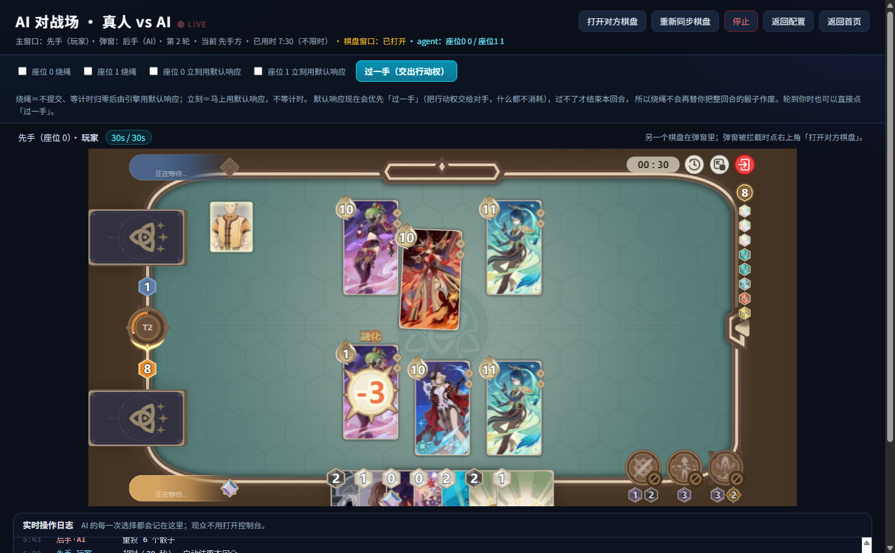
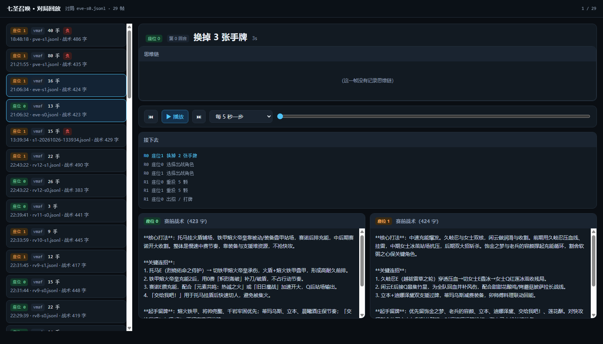

# 七圣召唤 AI 对战场 · Genius Invokation Agent

一个能**自己思考**跟你打《七圣召唤》的 AI：每手先写一段思维链（能看到它怎么权衡骰子、充能、保命），再给出一个动作；打完之后可以一帧一帧回放它的每一次决策。

> 非官方粉丝作品，与米哈游无关，仅供学习与交流，请勿用于商业用途。




## 它能做什么

- **真·AI 对手**：不是脚本，是每次请求都让大模型读当前局面（骰子、手牌、充能、双方出战角色、对手已出过的牌）再决策。
- **思考过程可见**：模型思维链落盘到会话文件，对局中控制台实时打印「🧠 思考 N 字」，回放台里逐字放映。
- **对局回放台**：按时间轴回放双方每一手，附带该手的思维链、赛前战术、耗时与 finish_reason；支持暂停/单步/2s/5s/8s 自动播放。
- **两个 AI 对打**：两个座位可以配**不同的模型、不同的厂商、不同的 Key**（DeepSeek / OpenAI / OpenRouter / 本地 ollama 都行，只要 OpenAI 兼容）。
- **赛前战术**：开局前可以手写一段战术 + 牌组码，AI 先解析牌组、结合战术写出一份赛前计划，后面每手都带着它打。
- **「过一手」**：引擎新增的 pass 动作——不想行动又不想结束回合时，交出行动权；烧绳超时也默认过一手，不会再把整回合骰子作废。
- **零依赖发行**：`release/build.py` 可以打出一个自带 Node + Python 运行时的 Windows 包，玩家解压双击就能玩，不用装环境。

## 架构

```
┌───────────────┐   SSE /api/arena/stream    ┌──────────────┐
│  对局页 7807   │ ─────────────────────────► │   AI 驱动     │
│  (引擎+赛事UI) │ ◄───────────────────────── │  driver/      │
└───────────────┘   HTTP POST /api/arena/…    └──────┬───────┘
                                                     │ POST /run（节点图）
                                                     ▼
                                              ┌──────────────┐
                                              │ 策略后端 8100 │  VMAF：
                                              │ ai-backend/   │  12 节点 39 边
                                              └──────┬───────┘  蓝图 = 提示词+校验+兜底
                                                     │
                                              ┌──────▼───────┐
                                              │  大模型 API   │
                                              └──────────────┘
```

- **游戏侧**（`engine/`）：七圣召唤模拟器 + AI 对战场桥接（SSE 推送决策请求、HTTP 收回答案）。
- **驱动**（`driver/`）：接请求、组 `shared`（局面、菜单、牌组、赛前计划、最近事件）、调后端、校验并回传；会话落盘、回放台、赛前备赛都在这里。
- **策略后端**（`ai-backend/`）：把「拼提示词 → 调模型 → 解析回答 → 兜底」做成可拖拽的节点图；决策蓝图 12 节点 39 边，改蓝图不用改代码。
- **模型**：任何 OpenAI 兼容接口。默认 `deepseek-flash`，思考长、便宜、够用。

## 快速开始 · 玩家（Windows，不装任何环境）

1. 到 [Releases](../../releases) 下载 `七圣召唤AI对战场-v1.0.zip`（约 52 MB）。
2. 解压到任意目录，双击 `开始游戏.bat`。
3. 第一次会让你粘贴一个 DeepSeek API Key（[怎么拿](https://platform.deepseek.com)，充 1 元能用很久）。
4. 浏览器自动打开对局页 → 选「真人 vs AI」→ 开始对局。
5. 打完看回放：`http://127.0.0.1:7812`。

## 快速开始 · 开发者

需要：Node 22+、Python 3.12+。**不需要** pnpm（`engine/packages/standalone/dist` 是提交好的构建产物）。

```bash
git clone https://github.com/Timtim00214/Genius-Invokation-Agent.git
cd Genius-Invokation-Agent

python -m pip install -r requirements.txt
cp driver/.env.example driver/.env      # 填 DEEPSEEK_API_KEY=sk-...
node 启动.mjs                            # 起 7807 / 8100 / 7810 / 7812 + AI 驱动
```

- 对局页 <http://127.0.0.1:7807>　观测台 <http://127.0.0.1:7810>　回放台 <http://127.0.0.1:7812>
- 真人坐后手：`node 启动.mjs --human 1`
- 带着战术开局：`node 启动.mjs --plan "先铺雷，第二回合开盾…"`
- 改引擎代码后：`cd engine && pnpm install && pnpm build`（否则跑的是提交好的 `dist`）

## 配置

所有模型配置都在 `driver/.env`（模板见 `.env.example`），两个座位互不影响：

```ini
# 座位 1（默认是 AI）
SEAT1_LLM_API_KEY=sk-xxxx
SEAT1_LLM_MODEL=deepseek-flash
SEAT1_LLM_API_BASE=https://api.deepseek.com/v1

# 座位 0（两个 AI 对打时才会用到）
SEAT0_LLM_API_KEY=sk-yyyy
SEAT0_LLM_MODEL=gpt-4o
SEAT0_LLM_API_BASE=https://api.openai.com/v1

# 两座位共用的兜底
LLM_MAX_TOKENS=16384
LLM_TIMEOUT_SECONDS=600
```

也可以直接用命令行覆盖（优先级更高）：`--llm-model` / `--llm-api-base` / `--llm-api-key-env` / `--llm-max-tokens` / `--llm-timeout-seconds`。

调参经验：`max_tokens=16384` 时一手约 30–60 秒；调到 8192 会有约三分之一的手被"思考截断"成空回复（会被兜底逻辑接住，但等于没听模型的）；限时给到 300 秒比较稳。

## 目录结构

```
engine/                 七圣召唤引擎 + 对局页（fork 自 piovium/genius-invokation，含 pass 改动与预构建 dist）
ai-backend/             AI 策略后端：节点图引擎 + 28 个插件节点 + 决策蓝图
driver/                 AI 驱动、蓝图、回放台、牌组码解析、会话记录
docs/img/               README 截图
release/build.py        生成 Windows 便携发行包（自带 Node / Python 运行时）
启动.mjs                 一键冷启动全部服务
requirements.txt        后端 Python 依赖
LICENSE                 AGPL-3.0
NOTICE.md               上游归属、改动清单、素材声明
```

## 测试

```bash
cd ai-backend/vmaf_system/backend && python -m pytest -q     # 398 passed
cd engine/packages/core && npx vitest run                     # 30 passed
```

## 已知限制

- 一手思考 20–60 秒，比人慢；快棋体验不佳（可以换更快的模型，但棋力会掉）。
- 一局成本在几分钱量级（`deepseek-flash`）。
- 只在 Windows 上验证过；macOS/Linux 需要自己装 Node/Python 并按 `启动.mjs` 起服务。
- 引擎内核被改过（新增 pass 动作），不能直接用上游的构建产物替换。
- 素材与卡牌数据版权归米哈游，仅随本项目作学习用途分发。

## 许可证与致谢

本项目以 **AGPL-3.0** 发布（沿用上游许可证），详见 [LICENSE](LICENSE) 与 [NOTICE.md](NOTICE.md)。

- 游戏引擎与对局页基座：[piovium/genius-invokation](https://github.com/piovium/genius-invokation)（AGPL-3.0）
- 卡牌数据/文本：来自上游仓库，版权归米哈游
