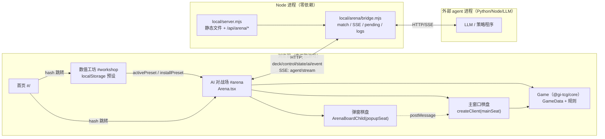
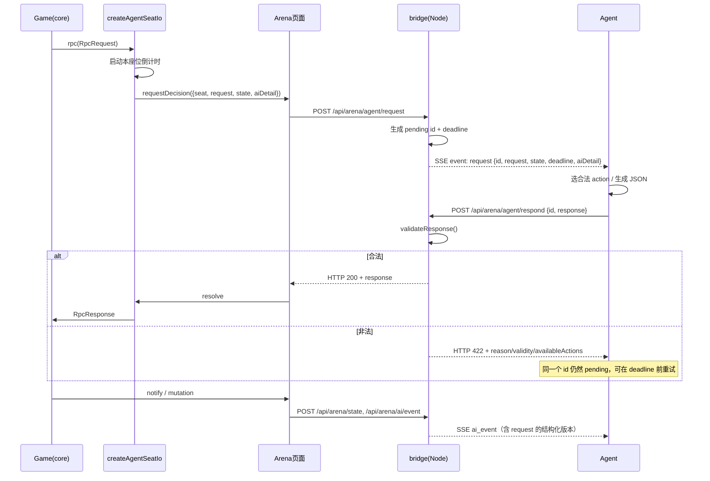
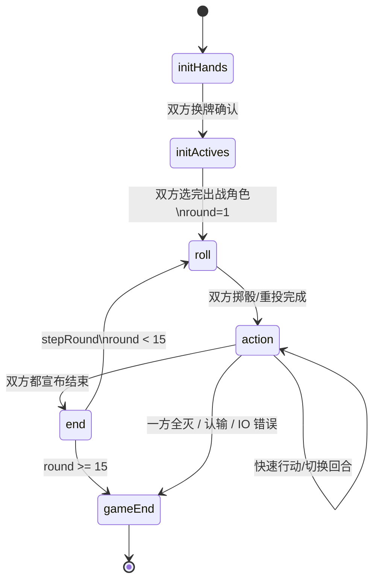

# 七圣召唤本地增强版：交接工作报告

> 适用版本：本地 `local` 分支，基于上游 `piovium/genius-invokation` 的 `5faa0675`（2026-10-23），游戏数据 `v7.1.0`。
> 写作日期：2026-10-25。
> 读者：接手本项目的下一位开发者 / 维护者 / Agent 作者。
> 相关文档：[`local/README.md`](local/README.md)、[`local/UPSTREAM.md`](local/UPSTREAM.md)、[`local/arena/API.md`](local/arena/API.md)。

---

## 0. 一页速览（先看这里）

这个项目在开源七圣召唤模拟器上增加了三块能力，**没有改动原版规则本身**：

1. **一键启动 / 可分发便携版**：自带 Node 运行时的 Windows 绿色包，双击 `.cmd` 即开；源码环境也有对应的启动脚本。
2. **数值工坊**：可视化查看全部角色/行动牌/技能数值，批量改生命、充能、卡牌伤害加成、卡牌与技能骰子费用；支持多套预设保存/切换/导入导出，原版预设永远保留。
3. **AI 对战场**：在原有“主窗口 + 弹窗”双棋盘结构上，把任意座位交给外部 agent（Python / Node / LLM 均可），通过本地 HTTP + SSE 接口收牌局事实、提交行动；支持真人 vs 真人、真人 vs AI、AI vs AI 三种模式，行动限时、整局限时、逐座位“耗时间”均可配置。

最重要的设计约束：

- **原版优先**：不启用预设、不开 AI 时，引擎数据与结算路径与原版一致；AI 只是替换了某个座位的 `PlayerIO`。
- **AI 不内置 LLM**：仓库只提供“事实流 + 决策接口 + 示例 agent”，LLM 的提示词、记忆、模型调用都在外部 agent 进程里。
- **对局在浏览器**：`Game` 运行在页面里，Node 侧只做静态文件和桥接；页面关闭 = 对局结束。
- **接口只监听 `127.0.0.1`**，没有鉴权，不要暴露公网。

最短上手路径：

```text
便携版：dist-portable/GeniusInvokation-Portable/Start.cmd
       dist-portable/GeniusInvokation-Portable/Workshop.cmd
       dist-portable/GeniusInvokation-Portable/Arena.cmd

源码版：Start.cmd / Workshop.cmd / Arena.cmd（根目录包装脚本）
       local/start-dev.cmd
       local/start-workshop.cmd
       local/start-arena.cmd
```

服务默认地址：`http://127.0.0.1:7717`；工坊 hash 是 `#workshop`，AI 对战场 hash 是 `#arena`。

> **注意**：上面的 `dist-portable/...` 是原始开发工作区的路径。如果你拿到的是轻量 `GeniusInvokation-Source.zip`，它**故意不含** `.git`、`dist-portable/`、`node_modules/` 和预构建 `packages/standalone/dist/`。这不是包损坏，而是“只给源码”的裁剪版；要交给下一位开发者/Agent 继续维护，请用 `GeniusInvokation-Dev.zip`（见 §4.0）。

---

## 1. 项目目标、边界与设计取舍

### 1.1 用户最初提出的目标

1. 把 `genius-invokation-main` 在本地跑起来，并做一个能发给别人、接收者也能快速启动的版本。
2. 卡牌数值确认可改，但改起来麻烦；要做修改界面，能查看全部数值、批量修改、保存预设并快速切换（例如“原版”“所有武器 100 伤害”）。
3. 最终让 LLM 参与游戏，分三种情况：
   - 两个真人玩：AI 不参与；
   - 人机对战：一个真人 + 一个 AI；
   - 两个 AI 对战；
   - 游戏时长可配置，LLM 思考慢时能调大；保留“耗时间/烧绳”打法，玩家和 LLM 可选择是否耗时间被动进下一轮。
4. 所有改动不能影响游戏本身玩法。
5. 上游每隔几个月加卡/调数值，GitHub 仓库也在更新，需要能跟进。

### 1.2 我们实际交付的边界

**做了：**

- 便携启动包、源码启动脚本、本地静态服务器；
- 数值工坊（角色/行动牌/技能，生命/充能/伤害加成/骰子费用，批量、预设、导入导出）；
- AI 对战场（双窗口、PvP/PvE/EvE、计时/耗时间、观战）；
- 桥接服务与 SSE/HTTP 接口；
- 结构化 AI 事件日志、完整快照、非法操作 422 反馈；
- 上游同步脚本与详细更新手册；
- 示例 agent、测试脚本、交接文档。

**没做（不要误以为有）：**

- 没有内置 LLM，也没有“自动打牌 AI”；`local/arena/example-agent.mjs` 只是“能结束就结束”的接口示例。
- 没有把 `Game` 搬到 Node 做后台常驻；页面关掉对局就结束。
- 没有做账号、鉴权、多房间、公网部署。
- 没有做任意技能脚本编辑；数值覆盖只覆盖明确列出的字段（见第 5 节）。
- 没有改原版卡牌实现来“硬编码”新数值；预设只在开局时注入。

### 1.3 关键设计原则

| 原则 | 具体做法 |
| --- | --- |
| 原版可复现 | 空预设时 `applyPresetToData` 直接返回同一个 `GameData` 对象；`installPreset(null)` 把钩子设为 `null` |
| 覆盖只发生在运行时 | 不修改 `packages/data` 源文件；每局创建 `GameData` 后再 patch |
| AI 是 IO 层替换 | 真人用 `createHumanSeatIo`，AI 用 `createAgentSeatIo`；引擎和卡牌逻辑不变 |
| 页面是唯一游戏进程 | 桥接只缓存状态/排队请求/转发 SSE，不跑 `Game` |
| 人类可围观 | AI 的棋盘始终在一个可见窗口里；PvE 时对 AI 手牌做隐藏，防偷看 |
| 先校验再进引擎 | 桥接在 `agent/respond` 做 422 预校验，避免 agent 的坏响应直接把游戏判 IO 负 |

---

## 2. 仓库结构、技术栈与“哪些是上游、哪些是我们加的”

### 2.1 目录树（只列与本次工作相关的）

```text
genius-invokation-main/
├─ package.json                 # pnpm workspace 根，engines.node ^26.12.1
├─ pnpm-workspace.yaml
├─ tsconfig.json
├─ packages/
│  ├─ core/                     # 游戏引擎：Game/GameState/RpcRequest/RpcResponse、阶段、结算
│  │  └─ src/
│  │     ├─ game.ts             # 阶段循环、initHands/initActives/roll/action/end/gameEnd
│  │     ├─ local_rules.ts      # [本地新增] 数值钩子接口
│  │     ├─ base/skill.ts       # [本地补丁] increaseDamage 钩子调用
│  │     ├─ runtime/skill_context.ts # [本地补丁] 技能基础伤害钩子调用
│  │     └─ index.ts            # 导出 get/setLocalRulesHooks
│  ├─ data/                     # 卡牌/角色 GTS 源码，构建成 data/dist
│  ├─ standalone/               # Web 应用（首页、工坊、AI 对战场）
│  │  └─ src/
│  │     ├─ index.tsx           # hash 路由：首页 / #workshop / #arena
│  │     ├─ workshop/           # Workshop.tsx、storage.ts、CostEditor.tsx、catalog
│  │     └─ arena/              # Arena.tsx、ArenaBoardChild.tsx、seatIo.ts、bridge.ts、aiEvents.ts
│  ├─ local-rules/              # [本地新增] 预设运行时 + catalog
│  │  └─ src/index.ts           # RulesPreset、applyPresetToData、installPreset
│  ├─ web-ui-core/              # 棋盘 UI 组件、createClient、WebUiPlayerIO
│  ├─ assets-manager/           # 卡图、牌组码编解码
│  ├─ deck-builder/             # 上游牌组编辑器
│  └─ ...                       # web-ui、server、test、typings 等上游包
├─ local/                       # [本地新增] 工具与桥接，不参与上游包发布
│  ├─ server.mjs                # 零依赖静态服务器 + /api/arena 桥接 + /api/health
│  ├─ arena/
│  │  ├─ bridge.mjs             # 桥接实现（match、SSE、请求队列、422 校验）
│  │  ├─ API.md                 # 给 agent 的完整接口文档
│  │  ├─ example-agent.mjs      # 示例 agent
│  │  ├─ decks.json             # 牌组库
│  │  └─ card-text.json         # 卡牌/技能/状态中文描述
│  ├─ gen-catalog.mjs           # 生成 packages/local-rules/src/catalog.json
│  ├─ gen-decks.mjs             # 生成 local/arena/decks.json
│  ├─ build-portable.mjs        # 打包 dist-portable
│  ├─ test-local.mjs            # 基础自测
│  ├─ check-patches.mjs         # 检查本地补丁是否还在
│  ├─ update-upstream.mjs/.cmd  # 上游同步
│  ├─ start-dev.cmd / start-workshop.cmd / start-arena.cmd
│  ├─ README.md / UPSTREAM.md
│  └─ _screenshots/             # 自测截图（非发布物）
├─ dist-portable/
│  ├─ GeniusInvokation-Portable/     # 解压即用目录
│  └─ GeniusInvokation-Portable.zip  # 约 39 MB，发给别人用这个
└─ patches/                     # 上游依赖 patch（pnpm patch）
```

### 2.2 技术栈

| 层 | 技术 |
| --- | --- |
| 包管理/构建 | pnpm 12.13.0、TypeScript、Vite、tsdown/tsup、`@gi-tcg/unplugin-gts` |
| UI | SolidJS、`@gi-tcg/web-ui-core` 棋盘组件 |
| 协议/数据 | Protobuf（`@bufbuild/protobuf`）、`RpcRequest/RpcResponse`、`ExposedGameState` |
| 卡牌数据 | 上游 GTS DSL（`packages/data/src/**/*.gts`），构建后 `data/dist` |
| 本地服务 | Node `node:http`，零第三方依赖；SSE 手写 |
| 桥接通信 | HTTP JSON + Server-Sent Events |
| 预设存储 | 浏览器 `localStorage` + JSON 导入导出 |
| 便携运行时 | 打包的 `node.exe`（26.12.1），Windows x64 |

开发机实际 Node 为 24.19 也能完成构建/运行；但仓库声明 `^26.12.1`，便携包内置 26.12.1，避免“接收者没装 Node”。

### 2.3 上游与本地的关系

- **上游**：`packages/core`、`packages/data`、`packages/standalone`（原版首页/本地模拟）、`web-ui-core` 等。
- **本地新增**：`packages/local-rules`、`packages/standalone/src/workshop`、`packages/standalone/src/arena`、`local/`。
- **本地小补丁**：`packages/core/src/local_rules.ts`、`base/skill.ts`、`runtime/skill_context.ts`、`standalone/src/index.tsx`（去掉 `@vercel/analytics`）。
- 所有本地提交都在 `local` 分支、`upstream/main` 之上，提交信息以 `local:` 开头；详见第 13 节。

---

## 3. 总体架构：浏览器、Node、Agent 三者如何联系

### 3.1 运行时拓扑



要点：

- **游戏引擎不在 Node 里**。`Game` 由 `Arena.tsx` 在浏览器中创建，Node 只负责把 agent 的决策送回页面、把页面的事实送出去。
- **弹窗不是第二个游戏**。弹窗是同一个 `Game` 的另一个“显示/操作客户端”，通过 `postMessage` 与主窗口交换 `notify`、`rpc`、`timer`。
- **agent 不是浏览器插件**。它是普通本地进程，连 `http://127.0.0.1:7717`；不要求同语言、不要求同仓库。

### 3.2 三个核心抽象

1. **`GameData`**：角色、行动牌、技能、状态等静态定义。由 `packages/data` 构建；工坊预设会在创建 `Game` 前 patch 它。
2. **`PlayerIO`**（`@gi-tcg/core`）：
   ```ts
   interface PlayerIO {
     notify(notification: Notification): void;
     rpc(request: RpcRequest): Promise<RpcResponse>;
     cancelRpc?(): void;
   }
   ```
   引擎通过 `notify` 推状态变化，通过 `rpc` 要决策。谁实现它，谁就是“玩家”。
3. **桥接服务**：把 `PlayerIO.rpc` 变成“SSE 推给 agent，等 HTTP 回复”。它同时保存每个座位最新 `state`、操作日志、结构化 AI 日志。

### 3.3 一次 AI 决策的时序



---

## 4. 启动、构建与分发

### 4.0 先确认你拿到的是哪个包

同一份代码有四种交付形态，用途不同，**不要拿轻量源码包当完整开发环境**：

| 包 | 内容 | 适用 | 体积 |
| --- | --- | --- | --- |
| `GeniusInvokation-Portable.zip` | 构建后的 `app/` + `node.exe` + 启动脚本 + `arena/` 数据 | 只想玩、改数值、接 agent | 约 39 MB |
| `GeniusInvokation-Source.zip` / `.tar.gz` | 源码；**无** `.git`、`node_modules`、`dist-portable`、预构建 `dist` | 只看代码、一次性构建 | 约 18 MB |
| `GeniusInvokation-Dev.zip` | 源码 + **完整 `.git`** + **预构建 `packages/standalone/dist`** + 便携 zip；无 `node_modules` | 下一任开发者/Agent 接手、继续跟进上游 | 约 140 MB |
| 原始开发工作区 | 上面全部 + `node_modules` + `.cache` + `.git` | 当前机器继续开发 | 约 1.4 GB |

如果你拿到的是 `GeniusInvokation-Source.zip`，那么下面这些现象都是**预期**，不是文件损坏：

- 没有 `.git`：无法 `git log` / `git branch` / `update-upstream`；
- 没有 `dist-portable/`：便携包要另外拿；
- 没有 `node_modules`、`packages/standalone/dist`：不能直接 `node local/server.mjs`，要先 `pnpm install` + `pnpm build "standalone..."`。

要做“接手后继续开发”，用 `GeniusInvokation-Dev.zip`，它把 `.git` 和预构建 `dist` 都带上了；`node_modules` 仍然不带（原因见 §4.4）。

### 4.1 四种启动方式

#### A. 便携版（给接收者）

路径：

```text
dist-portable/GeniusInvokation-Portable/
├─ Start.cmd          # 开首页（英文名，避免 zip 中文乱码）
├─ Workshop.cmd       # 开 #workshop
├─ Arena.cmd          # 开 #arena
├─ node.exe           # 26.12.1
├─ server.mjs
├─ arena/             # bridge.mjs、decks.json、card-text.json
├─ app/               # 前端 dist
├─ LICENSE            # AGPL-3.0
└─ README.txt
```

接收者只需解压整个 zip，双击对应 `.cmd`。服务监听 `127.0.0.1:7717`，脚本会打开浏览器。要求 Windows x64；不需要安装 Node、pnpm。SmartScreen 可能提示“未知发布者”，选择“更多信息 → 仍要运行”即可。

**为什么便携包里的 `.cmd` 用英文名**：zip 内中文文件名依赖 ZIP 的 UTF-8 标志位；旧版用 Windows `tar.exe` 打包时，名字按本机代码页写入且没有 UTF-8 标志，换一台机器解压就会变成 `AI u.cmd`、空白 `.cmd` 之类。现在构建脚本只写 ASCII 文件名（`Start.cmd` / `Workshop.cmd` / `Arena.cmd`），中文提示放在脚本内容与 `README.txt` 里，任何 Windows 解压工具都不会乱码。

#### B. 源码开发包（想改代码的接收者）

便携 zip 只有构建后的 `app/`（压缩过的 JS），不能用来改 UI/规则。要改代码，发源码包：

```text
dist-portable/GeniusInvokation-Source.zip      # Windows 友好，文件名全 ASCII
dist-portable/GeniusInvokation-Source.tar.gz   # 同样的内容，保留 Unix 风格
```

源码包约 18 MB，从当前 `HEAD` 导出，**不含** `node_modules`、`.git`、`dist-portable`、`local/.cache` 和构建产物。为了避开 Windows 复制/解压的两个老问题，做了两处处理：

- `packages/typings/proto` 原本是指向根目录 `proto/` 的符号链接，包内已展开成真实目录；
- `packages/server/public` 原本是指向 `packages/web-client/dist` 的符号链接，包内改为空目录 + `README.txt`；只开发 standalone 不需要它。

包内还有 `SOURCE-README.txt`，以及改名为 `HANDOVER-REPORT.md` 的交接报告。

接收者第一次构建：

```bat
:: 解压后进入 genius-invokation-main
pnpm install --frozen-lockfile
pnpm build "standalone..."
node local/server.mjs
```

浏览器打开 `http://127.0.0.1:7717/`。这条链路已实测：解压 → `pnpm install`（复用本机 pnpm store，约 9 秒）→ `pnpm build "standalone..."`（成功）→ `node local/server.mjs`（HTTP 200）。

改代码的位置：

| 想改什么 | 文件 |
| --- | --- |
| 数值预设/覆盖算法 | `packages/local-rules/src/index.ts` |
| 数值工坊 UI | `packages/standalone/src/workshop/` |
| AI 对战场 UI/座位 | `packages/standalone/src/arena/` |
| 页面与 agent 的桥接 | `local/arena/bridge.mjs` |
| 卡牌数据（GTS） | `packages/data/src/**/*.gts` |

改完重新 `pnpm build "standalone..."`，再启动 `node local/server.mjs`。不要直接改便携包的 `app/assets/*.js`，那是压缩后的产物，无法维护。

#### C. 完整开发交接包（推荐接手）

路径：

```text
dist-portable/GeniusInvokation-Dev.zip     # 约 140 MB，文件名全 ASCII
```

解压后顶层是 `genius-invokation-dev/`，包含：

| 内容 | 说明 |
| --- | --- |
| `.git/` | 完整仓库：分支 `local`、remote `upstream`、全部提交 |
| `packages/standalone/dist/` | 预构建前端，**不装 node_modules 也能直接启动** |
| `dist-portable/GeniusInvokation-Portable.zip` | 可直接发给玩家的便携包 |
| `README-FIRST.txt` | 拿到包先看这个 |
| `HANDOVER-REPORT.md` | 本报告 |
| 源码 + `local/` + `packages/local-rules` 等 | 改代码所需全部内容 |

它**不包含** `node_modules`（约 880 MB，3401 个符号链接，跨机器复制必坏）。第一次拿到后：

```bat
cd genius-invokation-dev
:: 只运行、不改代码：不需要 install
Start.cmd
:: 或
node local\server.mjs
```

已实测：不装 `node_modules`，直接 `node local/server.mjs --port 7806 --no-open` 返回 HTTP 200，`/api/arena/catalog` 返回 v7.1.0。

要改代码/重新构建：

```bat
pnpm install --frozen-lockfile
pnpm build "standalone..."
node local\server.mjs
```

Git 检查：

```bat
git status
git log --oneline
git remote -v
```

这个包在 `local` 分支上多了一个 `handoff: Windows-friendly source package layout` 提交：它只做两件事——把上游的两个符号链接换成真实目录，并把报告改名为 ASCII 的 `HANDOVER-REPORT.md`，让 Windows 解压后 `git status` 是干净的。

#### D. 源码环境（开发）

```bat
cd genius-invokation-main
pnpm install --frozen-lockfile
pnpm build
node local/gen-catalog.mjs
node local/gen-decks.mjs
node local/server.mjs --port 7717
```

或直接：

```text
local/start-dev.cmd
local/start-workshop.cmd
local/start-arena.cmd
```

这些脚本会检查/构建 `packages/standalone/dist`，再启动 `local/server.mjs`。

#### E. 只启动服务

```bat
node local/server.mjs --port 7717
node local/server.mjs --port 7717 --no-open
node local/server.mjs --port 7717 --root packages/standalone/dist --hash "#workshop"
```

参数（`local/server.mjs`）：

| 参数 | 默认 | 作用 |
| --- | --- | --- |
| `--port` | `7717` | 监听端口 |
| `--host` | `127.0.0.1` | 绑定地址（不要改 `0.0.0.0` 暴露公网） |
| `--root` | `packages/standalone/dist` | 静态文件目录 |
| `--hash` | 空 | 打开浏览器时附加 hash，如 `#workshop` / `#arena` |
| `--no-open` | 关 | 不自动开浏览器 |

`local/server.mjs` 还会挂 `/api/health`，并优先把 `/api/arena/*` 交给 `local/arena/bridge.mjs`，其余请求走静态文件。

### 4.2 构建链

```text
pnpm install
   ↓
pnpm build（core/data/standalone 等）
   ↓
node local/gen-catalog.mjs  → packages/local-rules/src/catalog.json
node local/gen-decks.mjs    → local/arena/decks.json
   ↓
node local/build-portable.mjs
   ↓
dist-portable/GeniusInvokation-Portable/ + .zip
```

`build-portable.mjs` 会复制前端 dist、`server.mjs`、`bridge.mjs`、`decks.json`、`card-text.json`、`node.exe`，生成中英文启动脚本和说明，再压 zip。当前 zip 约 39 MB。

### 4.3 自测入口

```bat
node local/test-local.mjs
```

它会检查：原版基线、预设覆盖（角色生命、武器伤害、技能伤害、骰子费用）、空预设不生效、静态页面可访问等。更偏 E2E 的脚本在 `local/_verify-*.mjs`（Puppeteer/CDP，非生产依赖），用于验证 PvP/PvE/EvE/工坊/便携版。

### 4.4 为什么所有包都不带 `node_modules`

`node_modules` 约 880 MB，含 3401 个符号链接，并且有超过 260 字符的路径（最长 307）。Windows 资源管理器复制/`Compress-Archive` 对符号链接、长路径、占用文件都不是可靠实现，这正是“复制整个项目文件夹失败”的原因。

所以：

- 便携包不带源码依赖；
- 源码包/开发交接包不带 `node_modules`，只带 `pnpm-lock.yaml`；
- 接收者必须在目标机器重新 `pnpm install --frozen-lockfile`；
- 不要用“复制 `node_modules`”来省安装时间，复制出来的链接很容易指向原机器路径。

如果确实要搬整个工作区，先关掉所有 node/dev server，用 `robocopy /E /XJ` 跳过 junction，再在新位置重新 `pnpm install`；更稳的是直接用 `GeniusInvokation-Dev.zip`。

---

## 5. 数值工坊：数据模型、覆盖规则与 UI

### 5.1 预设数据模型

`packages/local-rules/src/index.ts`：

```ts
export interface CharacterOverride {
  hp?: number;       // 生命上限；同时把初始生命设为该值
  energy?: number;   // 最大充能
}

export interface CardOverride {
  cost?: number;          // 打出总骰数；保留原费用类型，只改数量
  dice?: DiceRecord;      // 精确骰子消耗，优先于 cost
  damageBonus?: number;   // 该卡所有 increaseDamage(N) 的 N 统一替换
}

export interface SkillOverride {
  damage?: number;        // 该技能所有基础伤害统一替换
  cost?: number;          // 技能总骰数；保留原类型
  dice?: DiceRecord;      // 精确骰子消耗，优先于 cost
}

export interface RulesPreset {
  id: string;
  name: string;
  note?: string;
  builtin?: boolean;      // 内置“原版”，不可编辑/删除
  characters?: Record<string, CharacterOverride>;
  cards?: Record<string, CardOverride>;
  skills?: Record<string, SkillOverride>;
}
```

`DiceRecord` 的键是 `DiceType` 数字：

- 费用语义：`0=任意(Void)`，`1..7=冰/水/雷/火/风/岩/草`，`8=相同元素(Aligned)`，`9=充能`，`10=秘传`。
- 骰子面语义：`1..7=元素`，`8=万能(Omni)`。
- **两边 8 的含义不同**，这是 agent 最容易错的地方；接口文档里也专门强调了。

### 5.2 覆盖是如何生效的

开局前，`Arena.tsx` 调用：

```ts
installPreset(cfg.preset);      // 把伤害类钩子装进 core
const data = applyPresetToData(baseData, cfg.preset); // patch GameData
```

具体分四类：

| 覆盖 | 实现位置 | 行为 |
| --- | --- | --- |
| 角色生命/充能 | `applyPresetToData` → `patchCharacter` | 改 `varConfigs.maxHealth/health/maxEnergy` 的 `initialValue`；每局独立，不污染全局 |
| 卡牌费用 | `applyPresetToData` → `patchSkillCost` | 找到卡牌的 `playSkillOfCard` 技能，替换其 `requiredCost`；`dice` 精确覆盖，`cost` 只改总量 |
| 技能费用 | 同上，遍历角色 `skills` | 只处理带 `initiativeSkillConfig` 的技能 |
| 卡牌伤害加成 | `buildHooks().increaseDamage` | `caller.definition.id` 命中预设时替换 `increaseDamage(N)` 的 N |
| 技能基础伤害 | `buildHooks().baseDamage` | `skillId` 命中预设时替换 `:damage(type, N)` 的 N |

两个关键保护：

- `applyPresetToData(data, null/空预设)` **直接返回原对象**，不做任何 map 复制。
- `installPreset(null/空预设)` **把 hooks 设为 `null`**，core 里只是多一次 null 判断，结算路径不变。

因此“原版预设”不是“把所有值抄一遍”，而是“完全不注入”。

### 5.3 UI 结构

入口：首页按钮 / `#workshop` / `Workshop.cmd`。

- 顶部：预设下拉、`新建/复制/重命名/删除`、`导出/导入`、`保存预设`、`恢复原版数值`。
- 数据摘要：`数据版本 v7.1.0 · 155 名角色 · 597 张行动牌`。
- 三个 Tab：`角色 155`、`行动牌 597`、`技能 503`（技能只列“主动技能”，即带 `initiativeSkillConfig` 的技能；所以比角色/卡少）。
- 搜索：名称、ID、标签；`全选筛选结果`；示例 `所有武器 +100`。
- 批量条：`批量修改（对勾选条目）` + 数字 + `设为生命` / `设为充能`；只对当前 Tab 勾选项生效。
- 角色表：元素/武器、生命值输入、最大充能输入、技能基础伤害 chips。
- 行动牌表：类型、费用、伤害加成、费用骰子编辑。
- 技能表：所属角色、伤害、费用、费用骰子编辑。
- 每行左侧有“已修改”标记；顶部显示“当前改动 N 项”。
- 骰子编辑弹窗（`CostEditor.tsx`）支持 0–10 每种类型，显示“总计 N 骰”，可恢复默认。
- 预设存 `localStorage`；`原版` 是内置预设；改动未保存时自动形成“自定义（N 项改动）”；`保存预设` 才落成命名预设。
- 导出/导入为 JSON，便于备份和分享；导入会做基本结构校验。

### 5.4 使用示例：把所有武器改成 +100 伤害

1. 打开 `#workshop`。
2. Tab 选“行动牌”，搜索 `武器`，点“全选筛选结果”。
3. 批量条输入 `100`，点“设为伤害加成”（对应 `damageBonus`）。
4. 顶部点“保存预设”，命名如“武器 100”。
5. 回到 AI 对战场/开始对局；当前启用预设会随 `ArenaConfig` 传入。
6. 想恢复：选“原版”或点“恢复原版数值”。

角色批量生命同理：角色 Tab 勾选/全选 → 输入 100 → “设为生命”。注意这会把**生命上限和初始生命**都设为 100；不是只改当前血量。

### 5.5 边界与已知限制

- 只能改上面列出的字段；不能改卡牌效果逻辑、目标数、治疗量、护盾量、被动触发条件等。
- 技能 `damage` 会替换该技能所有基础伤害条目；多段伤害会全部变成同一个值。
- 卡牌 `damageBonus` 只作用于该卡牌实体作为 `caller` 的 `increaseDamage`；不改变卡牌的其他效果。
- 费用 `cost` 保留原费用的骰子类型，只调总量；要精确改类型必须用 `dice`。
- 预设只影响从工坊/对战场启动的对局；原版首页的“开始对局”不走预设（保持原版）。
- 预设按 ID 存储；上游删卡/改 ID 后，旧预设里的条目会失效但不会导致崩溃（找不到就跳过）。

---

## 6. AI 对战场：模式、双窗口、计时与可见性

### 6.1 三种模式

| 模式 | 代码 | 座位 0 | 座位 1 | 窗口 | Agent |
| --- | --- | --- | --- | --- | --- |
| 真人 vs 真人 | `pvp` | 真人 | 真人 | 主窗口 + 弹窗 | 不接 |
| 真人 vs AI | `pve` | 可选真人/可选 AI | 另一侧 | 主窗口 + 弹窗；AI 棋盘始终可见 | AI 座位接一个 |
| AI vs AI | `eve` | AI | AI | 主窗口 + 弹窗；人类纯观战 | 两个独立 agent |

`isHuman(who)` 的判定：

```ts
mode === "pvp" || (mode === "pve" && who === humanSeat)
```

`eve` 下两个座位都是 AI；`pvp` 下两个都是人。

### 6.2 双窗口布局（与上游本地模拟一致）

上游的本地模拟就是“一个窗口显示先手，另一个窗口显示后手”。我们没有改成单页双棋盘，而是保持：

```text
┌──────────────────────────── 主浏览器窗口 ────────────────────────────┐
│ 顶部：模式 / 座位 / 轮次 / 计时 / 耗时间开关 / 返回                │
│ 主棋盘：mainSeat（PvP 固定后手；PvE 真人座位；EvE 后手 AI）          │
│ 操作日志 / AI 状态 / 认输（仅人类）                                 │
└──────────────────────────────────────────────────────────────────────┘
┌──────────────────── 弹窗 window.open ────────────────────┐
│ 标题：先手/后手（座位 x）· 玩家/AI 视角                  │
│ 棋盘：popupSeat（另一个座位）                             │
│ 人类座位可操作；AI 座位 spectatorMode + disableAction     │
└──────────────────────────────────────────────────────────┘
```

座位公式（`Arena.tsx`）：

```ts
const mainSeat  = cfg.mode === "pve" ? cfg.humanSeat : 1;
const popupSeat = (1 - mainSeat) as 0 | 1;
```

- PvP：主窗口固定座位 1（后手），弹窗座位 0（先手）。
- PvE：主窗口是真人座位，弹窗是 AI 座位。
- EvE：主窗口座位 1，弹窗座位 0；两边都是 AI。

弹窗实现（`ArenaBoardChild.tsx`）：

- 弹窗里用 `createClient(who, { disableAction: !human })` 渲染棋盘；
- 主窗口通过 `postMessage({giTcg:"1.0", method:"notify"/"rpc"/"cancelRpc"/"timer"})` 驱动；
- 弹窗把 `rpc` 结果回传主窗口；
- 人类在弹窗点认输 → `giveUp`；
- 弹窗关闭：PvP 视为该方退出（判负）；PvE/EvE 只是隐藏这一侧棋盘，不结束对局，可重开弹窗。
- 浏览器阻止弹窗时，页面会提示；手动点“开始对局”仍会使用 agent 已选牌组。

### 6.3 信息可见性

| 场景 | 主窗口 | 弹窗 | Agent |
| --- | --- | --- | --- |
| PvP | 座位 1 全量 | 座位 0 全量 | 无 |
| PvE 真人 | 真人全量 | AI 座位：`hidePrivateInfo` 清空 AI 手牌/骰子/牌堆 | AI agent 拿到自己完整状态 |
| EvE | 座位 1 AI 观战 | 座位 0 AI 观战 | 各自完整状态 |

`hidePrivateInfo` 只影响**显示**：`createAgentSeatIo` 先保存完整 `lastState` 给 agent/请求，再把 `sanitizeNotification` 后的视图交给棋盘 UI。人类不能在 PvE 里偷看 AI 手牌，但 AI 自己看得到。

### 6.4 配置项（`ArenaConfig`）

| 字段 | 类型/默认 | 说明 |
| --- | --- | --- |
| `mode` | `pvp` / `pve` / `eve` | 对局模式 |
| `humanSeat` | `0` / `1` | PvE 时真人坐哪边 |
| `deck0` / `deck1` | 牌组码字符串 | 人类/默认牌组 |
| `deck0Data` / `deck1Data` | 解析后的 `{characters, cards, name}` | agent 选了牌组时覆盖牌组码 |
| `version` | `v7.1.0` | 数据版本 |
| `preset` | `RulesPreset` | 当前启用预设 |
| `actionSeconds` | `45`，范围 5–300 | 每次行动/挑牌限时 |
| `initSeconds` | `60`，范围 5–300 | 开局换牌/选人/重投限时 |
| `matchMinutes` | `0`（不限） | 整局上限，分钟 |
| `stall` | `[false,false]` | 两个座位各自“耗时间”开关 |

开局前页面每 2 秒轮询 `GET /api/arena/prepare`；满足“所有 AI 座位都有牌组 + `startRequested=true`”时自动 `start()`，否则等人点“开始对局”。

### 6.5 计时与“耗时间”

页面为每次 `rpc` 计时：

- `action` / `selectCard` 用 `actionSeconds`；
- 其他（`switchHands` / `chooseActive` / `rerollDice`）用 `initSeconds`。

超时默认响应（`defaultResponse.ts`）：

| 请求 | 默认响应 |
| --- | --- |
| `action` | 从合法行动里选 `declareEnd`；没有则第一个合法行动 |
| `chooseActive` | 第一个候选 |
| `selectCard` | 第一个候选 |
| `rerollDice` | `[]`（不重投） |
| `switchHands` | `[]`（不换） |

“耗时间”开关（每个座位独立）：

- 开启后页面**不请求 agent/不等待人类操作**，直接 `await sleep(total*1000)`，再返回默认响应；
- 用于复现“烧绳/被动进下一轮”的打法；玩家和 LLM 可以分别选择；
- 关闭时，agent 仍可故意延迟到 `deadline` 前再提交，效果类似“烧绳”。

整局上限：

- `matchMinutes > 0` 时，每秒检查；到达后 `finishByTime()`；
- 按双方**存活角色当前生命总和 / 最大生命总和**的比例判胜；比例相等判平局；
- 然后 `game.terminate()`，页面显示结果。

### 6.6 认输与异常

- 人类棋盘上有“认输”按钮；`game.giveUp(who)` → 对手胜。
- PvP 弹窗关闭 → 主窗口收到 `onGiveUp`，该方判负。
- AI 座位没有 UI 认输；agent 可以提交 `declareEnd`（结束回合）或让计时耗尽。
- 引擎 `GiTcgIoError`（非法/格式错误的 IO 响应）→ 对手胜；桥接的 422 校验会尽量在进入引擎前拦住。

---

## 7. 一局游戏的完整流程（引擎视角）

### 7.1 状态机



阶段枚举（`phase` 数字，AI 事件里的中文标签）：

| 数字 | 引擎名 | 中文标签 | 主要内容 |
| --- | --- | --- | --- |
| 0 | `initHands` | 准备手牌 | 发 5 张、换牌 |
| 1 | `initActives` | 选择出战角色 | 双方选出战角色、round=1 |
| 2 | `roll` | 掷骰 | 掷 8 个骰子、重投 |
| 3 | `action` | 行动 | 交替行动、出牌/技能/切人/结束 |
| 4 | `end` | 结束（召唤物结算） | 结束阶段、抽 2、回合数 +1 |
| 5 | `gameEnd` | 对局结束 | 结算胜负 |

### 7.2 开局（第 0 轮）

1. 页面创建 `Game`，为两个座位设置 `PlayerIO`。
2. `initHands`：
   - 双方各抽 `initialHandsCount = 5` 张；
   - `notifyAndPause()`；
   - 双方各发一次 `switchHands` 请求：玩家可把任意张初始手牌放回牌堆，从牌堆顶换回等量牌（`removedHandIds` 为空表示不换）；
   - 没有额外抽牌。
3. `initActives`：
   - 双方各发一次 `chooseActive` 请求（`candidateIds` 为 3 个角色）；
   - `postChooseActive` + `switchActive`；
   - 触发 `onBattleBegin`；
   - `stepRound` → `roundNumber = 1`；
   - 进入 `roll`。
4. `roll`：
   - 触发 `onRoundBegin`；
   - 每个座位先跑 `modifyRoll`（固定骰子、额外重投次数）；
   - 掷 `initialDiceCount = 8` 个骰子（`maxDiceCount = 16`）；
   - 每个座位发 `rerollDice` 请求；正常 `1 + extraRerollCount` 次机会，返回空数组会提前结束剩余重投；
   - 双方完成后进入 `action`。

### 7.3 每轮行动阶段

`actionPhase` 的核心顺序：

1. 当前行动方 `who = state.currentTurn`。
2. 如果该方 `declaredEnd`：直接 `switchTurn`，不请求。
3. 如果该方 `skipNextTurn`：清除标记并 `switchTurn`。
4. 否则：
   - 触发 `onBeforeAction`；
   - 设置 `canCharged`（骰子数为偶数）；
   - `clearPhaseLogs`；
   - 检查 `findReplaceAction`（某些卡/状态会替换行动）；有则直接执行并 `switchTurn`；
   - 否则 `availableActions()` 生成合法行动列表，发 `action` 请求；
   - 引擎校验 `chosenActionIndex` 范围、`validity === VALID`、`usedDice` 存在；
   - 执行行动（技能/打牌/切人/结束宣言等）；
   - 快速行动（`fast`）不切换回合；慢速行动/战斗行动通常切换回合；
   - 双方都 `declaredEnd` 后，`actionPhase` 返回 `end`。

`availableActions()` 里每个 action 的字段（agent 最常用）：

```json
{
  "action": { "$case": "useSkill", "value": { "skillDefinitionId": 11031, "targetIds": [], "mainDamageTargetId": -500013 } },
  "requiredCost": [{ "type": 1, "count": 1 }, { "type": 0, "count": 2 }],
  "autoSelectedDice": [1, 2, 2],
  "validity": 0,
  "preview": []
}
```

- `validity`：`0` 合法；`1` 条件不满足；`2` 没有可选目标；`3` 骰子不足；`4` 充能不足；`5` 被技能/状态禁用；`6` 秘传牌本局已用。
- `preview`：伤害/治疗等预览；数值工坊的覆盖会反映在这里。
- `usedDice` 可以省略或传空：桥接会自动用 `autoSelectedDice` 补齐，避免 agent 因为骰子选错被判负。

### 7.4 结束阶段

双方都宣布结束后进入 `end`：

1. 触发 `onEndPhase`；
2. 双方各抽 2 张（当前行动方先，然后另一方），受 `maxHandsCount = 10` 限制；
3. 触发 `onRoundEnd`；
4. 重置 `plungingStatus`、`hasDefeated` 等回合标记；
5. 清理回合日志；
6. `stepRound`：`roundNumber += 1`；
7. 若 `roundNumber >= maxRoundsCount = 15` → `gameEnd`（没有胜者则平局）；否则回到 `roll`。

### 7.5 胜负条件

| 条件 | 结果 |
| --- | --- |
| 一方 3 个角色全部倒下 | 另一方胜 |
| 人类点认输 / PvP 弹窗关闭 | 另一方胜 |
| `GiTcgIoError`（非法 IO） | 另一方胜 |
| 达到 15 轮 | 平局（`winner = null`） |
| 整局时间到 | 按生命比例判胜/平，然后 `terminate()` |

### 7.6 与 AI 请求的对应关系

| 阶段 | 可能发给 agent 的 `rpc` | 说明 |
| --- | --- | --- |
| `initHands` | `switchHands` | 开局换牌，一次 |
| `initActives` | `chooseActive` | 选出战角色，一次 |
| `roll` | `rerollDice` | 每轮 1 次，效果可增加次数 |
| `action` | `action` | 每次轮到该座位一次；包含所有合法行动 |
| `end` | 通常无 | 结束阶段触发的技能可能产生 `selectCard` / `chooseActive` 等 |
| 任意 | `selectCard` | 卡牌/技能要求挑牌时 |
| 任意 | `chooseActive` | 技能要求切人/选人时 |

---

## 8. 接口总览：输入、输出、事件与状态

这一节是交接重点。完整示例和字段解释见 [`local/arena/API.md`](local/arena/API.md)；下面给出“谁调用、输入什么、输出什么”的全景。

### 8.1 浏览器内部接口：`PlayerIO`

```ts
interface CancellablePlayerIO {
  notify(notification: Notification): void;
  rpc(request: RpcRequest): Promise<RpcResponse>;
  cancelRpc?(): void;
}
```

- `notify`：引擎 → IO。`notification` 包含 `state`、`mutation` 等；`state` 是 `ExposedGameState`。
- `rpc`：引擎 → IO。`request` 是 `RpcRequest`，形如：
  ```ts
  { request: { $case: "action", value: { action: ActionInfo[] } } }
  ```
- `RpcResponse` 必须完整：
  ```ts
  { response: { $case: "action", value: { chosenActionIndex: 0, usedDice: [1,2,2] } } }
  ```
- 人类实现：`createHumanSeatIo`，内部包 `WebUiPlayerIO`（棋盘 UI）。
- AI 实现：`createAgentSeatIo`，内部把 `rpc` 转给桥接，把 `notify` 转成棋盘显示 + 结构化事件。

### 8.2 页面 ↔ 桥接：HTTP 接口全表

所有路径以 `/api/arena` 开头；默认 `matchId=local`。除特别说明外，请求/响应都是 JSON。

| 方法 | 路径 | 调用方 | 输入 | 输出/说明 |
| --- | --- | --- | --- | --- |
| GET | `/catalog` | 页面/agent | 无 | `{version, generatedAt, counts, characters[], cards[], tokens[], skills[]}`；名称、生命、充能、费用、费用骰子、基础伤害 |
| GET | `/decks` | agent/页面 | 无 | `{version, decks:[{id,name,note,code,characters:[{id,name}],cards:[{id,name,count}]}]}` |
| GET | `/card-text` | agent | 无 | `{version, descriptions:{"<definitionId>":"中文描述"}}` |
| GET | `/deck?seat=0\|1` | 页面/agent | `seat` | 该座位已选牌组；没有则 404 |
| POST | `/deck` | agent | `{matchId?, seat, deckId?}` 或 `{characters:[id,id,id], cards:[id...]}`；可带 `note` | 200 `{ok, seat, deck, matchId}`；422 `{error, reason, ...}` |
| GET | `/prepare` | 页面 | `matchId?` | `{matchId, decks:{0,1}, startRequested, startRequestedAt, agents:{0,1}, aiSeq}` |
| POST | `/control` | agent/页面 | `{matchId?, action:"start"\|"clear"}` | `{ok, startRequested}`（start）或 `{ok:true}`（clear） |
| GET | `/status` | 页面/agent | `matchId?` | `{matchId, updatedAt, seq, agents:{0,1}, pending:{0,1}, pendingRequests[], logCount, config, aiSeq, aiLogCount, decks:{0,1}}` |
| GET | `/state?seat=0\|1` | 页面/agent | `seat` | `{seat, state}`；不带 seat 返回 `{states:{0,1}}` |
| POST | `/state` | 页面（内部） | `{matchId?, seat?, state?}` 或 `{states}` | `{ok, seq}`；写状态并广播 |
| GET | `/spectate` | 调试/观众 | 无 | `{status, states:{0,1}, logs}`；**包含双方完整状态，仅本地调试** |
| GET | `/log` | 页面/agent | 无 | 最近 500 条操作日志 |
| POST | `/reset` | 页面 | `{matchId?}` | `{ok:true}`；清空对局数据（AI 日志保留并追加 `match_reset`） |
| GET | `/agent/stream?matchId=local&seat=1` | agent | `Accept: text/event-stream` | SSE；见 8.3 |
| POST | `/agent/request` | 页面（内部） | `{matchId?, seat, request, state?, config?, timeoutMs?, aiDetail?}` | 长轮询，返回 `{id,response}` 或 `{timeout:true}`；页面用，不建议 agent 直接调 |
| POST | `/agent/respond` | agent | `{matchId?, id, response: RpcResponse}` | 200 `{ok:true, id}`；404 请求不存在/已过期；422 非法，见 8.5 |
| POST | `/ai/event` | 页面（内部） | `{matchId?, seat, events:[...]}` | `{ok, seq}`；写结构化 AI 日志并广播 |
| GET | `/ai/log?seat=1&since=0&limit=200` | agent | `seat`、`since`、`limit` | `{events:[{seq,at,seat,event}], lastSeq, nextSince?}`；最多保留 20000 条 |
| GET | `/ai/snapshot?seat=1` | agent | `seat` | `{snapshot, seq}`；最近一次 `snapshot` 事件 |
| GET | `/api/health` | 运维 | 无 | `{ok:true}`（由 server.mjs 提供） |

补充：

- `GET /catalog` 的 `counts` 当前为 `{characters:155, cards:597, skills:...}`；`skills` 包含被动/触发技能，工坊的“技能”Tab 只筛选主动技能。
- 牌组校验（`POST /deck`）：
  - 恰好 3 个不重复角色，且在卡池；
  - 恰好 30 张行动牌；
  - 同名卡最多 2 张；
  - 秘传牌最多 1 种；
  - 失败 422，返回具体 `reason`。
- 页面开局时会先 `POST /reset`，再创建新 `Game`；桥接的 AI 日志不会清空，而是用 `match_reset` 分段，方便 agent 保留“选牌/开局”上下文。
- 桥接只监听 `127.0.0.1`，没有鉴权；`/spectate` 和 `/state` 不应用于公网。

### 8.3 SSE：agent 连接

```http
GET /api/arena/agent/stream?matchId=local&seat=1
Accept: text/event-stream
```

事件：

| event | data | 说明 |
| --- | --- | --- |
| `hello` | `{matchId, seat, aiSeq, status, pending}` | 连接成功；`pending` 是当前未处理的请求，重连后应补答 |
| `state` | `{seat, state, seq}` | 该座位最新可见状态 |
| `request` | `{id, matchId, seat, request, state, deadline, aiDetail}` | 轮到你决策；`aiDetail` 是结构化版本（actions/hand/dice） |
| `ai_event` | `{seq, at, seat, event}` | 结构化事实流（见 8.6） |
| `responded` | `{id}` | 请求已被处理（可能是自己或超时后的默认） |
| `timeout` | `{id, seat}` | 请求已超时 |
| `reset` | `{}` | 开了新一局，清空状态 |

SSE 是**单向推送**；agent 提交行动必须另发 `POST /agent/respond`。连接会每 15 秒发 `: keepalive` 注释帧，防止代理断流。

### 8.4 五种 `rpc` 请求与响应

| 请求 `$case` | 请求 value | 响应 value | 注意 |
| --- | --- | --- | --- |
| `rerollDice` | `{ diceToReroll: DiceType[] }` | `{ diceToReroll: DiceType[] }` | 空数组 = 不重投；每个值必须在当前骰子里存在；`attempt` 从 0 开始 |
| `switchHands` | `{ removedHandIds: number[] }` | `{ removedHandIds: number[] }` | 空数组 = 不换；ID 必须在手牌里 |
| `chooseActive` | `{ candidateIds: number[] }` | `{ activeCharacterId: number }` | 必须从候选里选 |
| `selectCard` | `{ candidateDefinitionIds: number[] }` | `{ selectedDefinitionId: number }` | 必须从候选里选 |
| `action` | `{ action: ActionInfo[] }` | `{ chosenActionIndex: number, usedDice?: DiceType[] }` | 只能选 `validity=0`；`usedDice` 可省略，桥接自动补 |

`action` 请求示例（SSE `request.request`）：

```json
{
  "request": {
    "$case": "action",
    "value": {
      "action": [
        {
          "action": { "$case": "useSkill", "value": { "skillDefinitionId": 11031, "targetIds": [], "mainDamageTargetId": -500013 } },
          "requiredCost": [{ "type": 1, "count": 1 }, { "type": 0, "count": 2 }],
          "autoSelectedDice": [1, 2, 2],
          "validity": 0,
          "preview": []
        },
        {
          "action": { "$case": "declareEnd", "value": {} },
          "requiredCost": [],
          "autoSelectedDice": [],
          "validity": 0,
          "preview": []
        }
      ]
    }
  }
}
```

响应示例：

```json
{
  "matchId": "local",
  "id": 12,
  "response": {
    "response": {
      "$case": "action",
      "value": { "chosenActionIndex": 0, "usedDice": [1, 2, 2] }
    }
  }
}
```

### 8.5 非法操作：422 + 重试

如果下标越界、选了 `validity != 0`、角色/挑牌不在候选、换牌不在手牌、重投骰子不存在，桥接返回 422，**不结束请求**，agent 可在 `deadline` 前重试：

```json
{
  "error": "invalid response",
  "requestId": 12,
  "reason": "该行动当前不可用：骰子不足",
  "validity": 3,
  "validityLabel": "骰子不足",
  "action": { "index": 4, "kind": "useSkill" },
  "disabledBy": [],
  "availableActions": [
    { "index": 0, "kind": "useSkill", "validity": 0 },
    { "index": 9, "kind": "declareEnd", "validity": 0 }
  ]
}
```

- `disabledBy`：出战角色身上带 `disableSkill` 的状态（如冻结）。
- 卡牌条件不满足会带 `willBeEffectless`，提示“打出去也没效果”。
- 同时会向该座位写一条 `action_rejected` 结构化事件，内容同上。
- 如果 agent 一直不合法，deadline 到后页面按默认响应处理，不会卡死。

### 8.6 结构化 AI 日志（事实流）

页面在每次 `notify` 时把引擎的 mutation 翻译成事件，`POST /ai/event` 写入桥接；agent 有两条获取途径：

1. SSE `ai_event`（实时）；
2. `GET /ai/log?seat=1&since=<seq>&limit=200`（补历史/轮询）。

每条记录：

```json
{ "seq": 123, "at": 1792910000000, "seat": 1, "event": { "type": "damage", "...": "..." } }
```

`seat: null` 表示公开事件（双方都能看）；`seat: 0/1` 是座位私有。日志最多 20000 条，`lastSeq` 用于下次 `since`。

事件类型（`aiEvents.ts` 实际生成）：

| type | 内容 |
| --- | --- |
| `snapshot` | 完整局面。开局、每回合结束（召唤物结算后）、对局结束各一次 |
| `request` | 轮到你做选择：`actions` / `hand` / `dice` / `candidates`；每个 action 带 `validity`、`cost`、`preview` |
| `decision` | 某方做出的选择（公开） |
| `dice` | 掷骰/消耗/生成/转化；自己的骰子有值，对手只有 `diceCount` |
| `reroll` | 重投结果（重投了几个） |
| `switch_hands` | 开局换牌结果 |
| `choose_active` | 选出战角色结果 |
| `select_card` | 挑牌结果 |
| `skill` | 谁用了/触发了什么技能（`triggeredOn` 说明触发源） |
| `damage` | 来源、目标、数值、元素、反应、前后血量、是否击倒 |
| `heal` | 治疗来源、目标、数值、前后血量 |
| `variable` | 生命/充能/护盾/可用次数等变量变化（`oldValue → value`） |
| `create_entity` / `remove_entity` / `move_entity` | 状态、召唤物、支援、装备的增删移动 |
| `create_attachment` / `transform` / `reset_variables` | 附魔/变身/每回合重置 |
| `switch_active` / `swap_characters` | 切人/换位 |
| `player_flag` / `player_status` | 结束宣言、秘传已用、玩家状态 |
| `phase` / `round` / `turn` | 阶段/回合/行动方 |
| `winner` | 胜负 |
| `trigger` | 引擎触发的事件名（`handleEvent`） |
| `action_rejected` | agent 提交非法操作 |
| `deck_selected` / `start_requested` | 选牌组/请求开局（公开） |
| `match_reset` | 新一局开始；日志保留旧选牌记录，用这个事件分段 |
| `error` | 桥接/页面错误 |

### 8.7 回合结束快照

每次 `stepRound`（召唤物等结束结算之后）生成，`reason: "round_end"`；开局 `reason: "start"`；结束 `reason: "game_end"`。核心字段：

```json
{
  "type": "snapshot",
  "reason": "round_end",
  "round": 5,
  "phase": "掷骰",
  "currentTurn": 0,
  "winner": null,
  "me": {
    "seat": 0,
    "activeCharacterId": -500000,
    "activeCharacterName": "凯亚",
    "characters": [
      {
        "id": -500000,
        "definitionId": 1103,
        "name": "凯亚",
        "health": 8,
        "maxHealth": 10,
        "energy": 2,
        "maxEnergy": 2,
        "aura": "冰",
        "defeated": false,
        "tags": { "raw": 0, "disableSkill": false, "shield": false },
        "equipment": [{ "definitionId": 311501, "name": "旅行剑", "variableName": null }],
        "statuses": [{ "definitionId": 106, "name": "冻结", "variableName": "usage", "variableValue": 1 }],
        "entities": []
      }
    ],
    "handCount": 5,
    "hand": [{ "id": -500003, "definitionId": 311501, "name": "旅行剑", "cost": { "text": "2相同元素" } }],
    "diceCount": 8,
    "dice": [8, 3, 1, 1, 7, 7, 2, 5],
    "diceLabels": ["万能", "火", "冰", "冰", "草", "草", "水", "风"],
    "pileCount": 20,
    "supports": [{ "definitionId": 322001, "name": "派蒙", "variableName": "usage", "variableValue": 2 }],
    "summons": [],
    "combatStatuses": [],
    "declaredEnd": false,
    "legendUsed": false,
    "initiativeSkills": [
      { "id": 11031, "name": "仪典剑术", "cost": { "1": 1, "0": 2 }, "costText": "1冰+2任意元素" }
    ]
  },
  "opponent": {
    "seat": 1,
    "activeCharacterName": "托马",
    "characters": ["..."],
    "handCount": 6,
    "diceCount": 8,
    "supports": ["..."],
    "summons": ["..."],
    "combatStatuses": ["..."],
    "declaredEnd": true
  }
}
```

- `me` 是完整的自己；`opponent` 只有公开信息（手牌/骰子只有数量）。
- 角色的 `equipment` / `statuses` 带 `definitionId`、名字、可见变量（`variableName`/`variableValue`）。
- `initiativeSkills` 给出当前可用主动技能的费用。
- 随时可取最新快照：`GET /ai/snapshot?seat=1`。

### 8.8 状态 `state` 结构

`/state`、SSE `state`、`request.state` 都是 `ExposedGameState`（protobuf JSON）。关键字段：

```json
{
  "currentTurn": 0,
  "phase": 3,
  "roundNumber": 2,
  "player": [
    {
      "activeCharacterId": -500000,
      "dice": [8, 3, 1],
      "handCard": [{ "id": -500003, "definitionId": 311501, "type": 3, "tags": [] }],
      "character": [
        {
          "id": -500000,
          "definitionId": 1103,
          "variables": { "health": 10, "maxHealth": 10, "energy": 2, "maxEnergy": 2, "aura": 0 }
        }
      ],
      "combatStatus": [],
      "summon": [],
      "support": [],
      "declaredEnd": false
    },
    { "对手的公开信息": "..." }
  ]
}
```

- `player[0].handCard` / `dice` 等私有字段只对“该座位自己的 state”完整；对手只有公开信息。
- `/spectate` 是例外：为了调试，它返回双方桥接缓存的状态；**不要拿它当公平对局接口**。

### 8.9 计时、错误与安全

- 每次 `rpc` 都有页面计时；超时默认响应见 6.5。
- `agent/request` 的服务端超时 = 页面传的 `timeoutMs`（默认 60000，范围 1s–10min）；页面实际传 `total*1000 + 1500`，所以 agent 比页面多 1.5 秒缓冲。
- `agent/respond` 的 422 不结束请求；404 表示 id 不存在/已过期；400 表示缺 `id`/`response` 或 seat 非法。
- 桥接请求体上限 8 MB；SSE 每 15 秒 keepalive。
- 只监听 `127.0.0.1`；没有鉴权；LLM 的 API key 只放 agent 进程，不要写进网页或通过接口传。
- 页面关闭 = 对局结束；要“后台常驻对局”需要把 `Game` 搬到 Node，当前没做。

---

### 8.10 关键接口的请求/响应示例

以下只列关键字段；完整字段与边界条件以 [`local/arena/API.md`](local/arena/API.md) 为准。

**选牌组（agent）**

```http
POST /api/arena/deck
Content-Type: application/json

{
  "matchId": "local",
  "seat": 1,
  "deckId": "builtin-2",
  "note": "雷火快攻，先手留托马"
}
```

```json
{
  "ok": true,
  "matchId": "local",
  "seat": 1,
  "deck": {
    "name": "托马雷火",
    "code": "FdHx...",
    "characters": [
      { "id": 1103, "name": "凯亚" },
      { "id": 1202, "name": "托马" },
      { "id": 1307, "name": "赛诺" }
    ],
    "cards": [{ "id": 311501, "name": "旅行剑", "count": 2 }]
  }
}
```

**准备状态（页面轮询）**

```http
GET /api/arena/prepare?matchId=local
```

```json
{
  "matchId": "local",
  "decks": {
    "0": { "name": "人类牌组", "code": "FZB..." },
    "1": { "name": "托马雷火", "code": "FdHx..." }
  },
  "startRequested": true,
  "startRequestedAt": 1792910000000,
  "agents": { "0": false, "1": true },
  "aiSeq": 3
}
```

**请求开局（agent）**

```http
POST /api/arena/control
Content-Type: application/json

{ "matchId": "local", "action": "start" }
```

```json
{ "ok": true, "startRequested": true }
```

**同步状态（页面内部）**

```http
POST /api/arena/state
Content-Type: application/json

{
  "matchId": "local",
  "seat": 1,
  "state": { "currentTurn": 0, "phase": 3, "roundNumber": 2, "...": "..." }
}
```

```json
{ "ok": true, "seq": 12 }
```

**写结构化事件（页面内部）**

```http
POST /api/arena/ai/event
Content-Type: application/json

{
  "matchId": "local",
  "seat": 1,
  "events": [
    { "type": "phase", "phase": "action", "label": "行动" },
    { "type": "damage", "source": "凯亚", "target": "托马", "amount": 3 }
  ]
}
```

```json
{ "ok": true, "seq": 13 }
```

**补历史事件（agent）**

```http
GET /api/arena/ai/log?matchId=local&seat=1&since=10&limit=50
```

```json
{
  "events": [
    { "seq": 11, "at": 1792910000000, "seat": 1, "event": { "type": "round", "round": 2 } },
    { "seq": 12, "at": 1792910000100, "seat": 1, "event": { "type": "phase", "phase": "action" } }
  ],
  "lastSeq": 13
}
```

**最近完整快照（agent）**

```http
GET /api/arena/ai/snapshot?matchId=local&seat=1
```

```json
{
  "snapshot": {
    "type": "snapshot",
    "reason": "round_end",
    "round": 2,
    "phase": "掷骰",
    "currentTurn": 0,
    "me": { "seat": 1, "activeCharacterName": "托马", "health": 10 },
    "opponent": { "seat": 0, "activeCharacterName": "凯亚", "health": 10 }
  },
  "seq": 13
}
```

**提交行动（agent）**

```http
POST /api/arena/agent/respond
Content-Type: application/json

{
  "matchId": "local",
  "id": 12,
  "response": {
    "response": {
      "$case": "action",
      "value": { "chosenActionIndex": 0, "usedDice": [1, 2, 2] }
    }
  }
}
```

```json
{ "ok": true, "id": 12 }
```

**对局状态（页面/agent）**

```http
GET /api/arena/status?matchId=local
```

```json
{
  "matchId": "local",
  "updatedAt": 1792910000000,
  "seq": 13,
  "agents": { "0": false, "1": true },
  "pending": { "0": 0, "1": 1 },
  "pendingRequests": [
    { "seat": 1, "id": 12, "kind": "action", "createdAt": 1792910000000, "deadline": 1792910045000 }
  ],
  "logCount": 40,
  "config": { "actionSeconds": 45, "initSeconds": 60, "matchMinutes": 0, "stall": [false, false] },
  "aiSeq": 13,
  "aiLogCount": 27,
  "decks": { "0": { "name": "人类牌组" }, "1": { "name": "托马雷火" } }
}
```

---

## 9. 如何配置和接入一个 Agent（重点）

### 9.1 先决定 agent 坐哪边

| 模式 | 谁需要 agent | 连接 seat |
| --- | --- | --- |
| PvP | 不需要 | — |
| PvE，真人先手 | AI 是后手 | `seat=1` |
| PvE，真人后手 | AI 是先手 | `seat=0` |
| EvE | 两个 agent | 一个 `seat=0`，一个 `seat=1` |

页面上的“座位 0（先手）/座位 1（后手）”和 SSE 的 `seat` 必须一致。PvE 下人类坐的那一侧不要连 agent，否则会和人类 UI 抢请求。

### 9.2 启动顺序

1. 启动服务（便携版或 `local/start-arena.cmd`）。
2. 浏览器打开 `http://127.0.0.1:7717/#arena`。
3. 选择模式：
   - PvE：选“真人 vs AI”，选真人坐哪边；
   - EvE：选“AI vs AI”；
   - PvP：不需要 agent。
4. 设置两个牌组码（人类座位用；AI 座位可被 agent 选牌覆盖）。
5. 设置行动限时/开局限时/整局上限/耗时间开关。
6. 启动 agent，让它连 SSE。
7. agent 选牌组（可选）并 `POST /control {action:"start"}`；
   页面每 2 秒轮询，满足条件会自动开局；弹窗被拦截就手动点“开始对局”。
8. agent 处理 `request`，提交 `respond`；直到 `winner`/`game_end`。

### 9.3 Agent 的最小状态机

```text
连接 SSE
  ├─ hello:
  │   记录 matchId/seat/自上次的 pending
  │   如果有 pending，逐个补答（先读 request/aiDetail）
  ├─ state:
  │   更新本地 state 缓存（可选，request 里也有）
  ├─ ai_event:
  │   追加结构化日志；维护 snapshot/round/血量/手牌缓存
  ├─ request:
  │   1. 读 request.request.$case
  │   2. 读 request.state / aiDetail
  │   3. 选合法响应
  │   4. POST /api/arena/agent/respond {id, response}
  │   5. 422 → 读 reason/availableActions → 重选 → 重试
  ├─ timeout:
  │   页面已按默认响应处理；不要再回复
  └─ reset:
      清空本地对局缓存，保留牌组笔记
```

### 9.4 选牌组（可选，但推荐）

Agent 可以在开局前：

```http
GET /api/arena/decks
GET /api/arena/card-text
POST /api/arena/deck
{
  "matchId": "local",
  "seat": 1,
  "deckId": "builtin-2",
  "note": "我想用托马+赛诺打雷火，所以选这套"
}
```

- `note` 会显示在页面“AI 已选”旁边，也会写入 `deck_selected` 事件；适合放 LLM 的构造思路/笔记。
- 也可以直接传 `characters` + `cards` 数组，服务端校验。
- 选完再 `POST /control {action:"start"}`。
- 如果 agent 不选，页面仍可用默认牌组码手动开局；但自动开局要求 AI 座位有 `decks[seat]`。

### 9.5 处理 `request` 的通用策略

1. 只选 `validity === 0` 的 action。
2. `usedDice` 直接复制该 action 的 `autoSelectedDice`，不要自己重排；否则容易“骰子不存在”。
3. `declareEnd` 是合法 action 之一；想结束回合就选它。
4. `chooseActive` / `selectCard` 从候选数组里选；不要选候选外。
5. `rerollDice` 只重投想换的骰子面；返回 `[]` 表示不重投；`attempt` 告诉你这是第几次重投。
6. 收到 422 时，优先看 `availableActions`，直接在合法集合里重选；不要盲目重发同一个响应。
7. 用 `deadline` 控制节奏：想“烧绳”就等到接近 deadline 再提交；但页面可能先超时，留 1–2 秒余量。

### 9.6 LLM 接入建议

- **上下文**：给 LLM 的不是原始 protobuf，而是 `request` 的 `aiDetail` + 最近 `snapshot` + 最近 N 条 `ai_event` + `catalog`/`card-text` 的名称解释。
- **动作空间**：把 `action` 数组转成“编号 + 中文描述 + 费用 + validity”，让模型只返回编号；不要让它自由生成 JSON 结构。
- **记忆**：每回合结束的 `snapshot` 是最可靠的“全局事实”；`ai_event` 是增量。两者冲突时以更新的 `snapshot` 为准。
- **重试**：模型输出不合法 → 把 422 的 `reason`/`availableActions` 回填给模型，再让它选一次；不要直接放弃。
- **超时**：LLM 慢就把 `actionSeconds` 调到 120–300；页面最大 300 秒。再长只能开“耗时间”或让 agent 先回默认。
- **成本**：不需要把 20000 条日志全塞进 prompt；用 `since` 增量 + 每回合 snapshot。
- **安全**：API key 只在 agent 进程；prompt 里不要放 key；不要将 7717 暴露公网。

### 9.7 最小 Python 骨架

```python
import json, threading, urllib.request

BASE = "http://127.0.0.1:7717"
SEAT = 1

def post(path, body):
    data = json.dumps(body).encode()
    req = urllib.request.Request(BASE + path, data=data,
                                 headers={"Content-Type": "application/json"})
    return urllib.request.urlopen(req).read()

def default_response(rpc):
    case = rpc["request"]["$case"]
    value = rpc["request"]["value"]
    if case == "action":
        actions = value["action"]
        idx = next((i for i, a in enumerate(actions)
                    if a["action"]["$case"] == "declareEnd" and a["validity"] == 0), 0)
        return {"response": {"$case": "action", "value": {
            "chosenActionIndex": idx,
            "usedDice": actions[idx].get("autoSelectedDice", []),
        }}}
    if case == "chooseActive":
        return {"response": {"$case": "chooseActive", "value": {
            "activeCharacterId": value["candidateIds"][0]}}}
    if case == "selectCard":
        return {"response": {"$case": "selectCard", "value": {
            "selectedDefinitionId": value["candidateDefinitionIds"][0]}}}
    if case == "rerollDice":
        return {"response": {"$case": "rerollDice", "value": {"diceToReroll": []}}}
    return {"response": {"$case": "switchHands", "value": {"removedHandIds": []}}}

def on_request(data):
    body = {"matchId": "local", "id": data["id"],
            "response": default_response(data["request"])}
    try:
        post("/api/arena/agent/respond", body)
    except urllib.error.HTTPError as e:
        # 422: 读 reason/availableActions，重新决策后重试
        print(e.code, e.read().decode())

# SSE 读取（生产建议 httpx-sse / requests-sse）
with urllib.request.urlopen(f"{BASE}/api/arena/agent/stream?matchId=local&seat={SEAT}") as r:
    event, buf = "message", ""
    for raw in r:
        line = raw.decode("utf-8").rstrip("\n")
        if line == "":
            if buf:
                data = json.loads(buf)
                if event == "request":
                    on_request(data)
            event, buf = "message", ""
        elif line.startswith("event: "):
            event = line[7:]
        elif line.startswith("data: "):
            buf += line[6:]
```

示例 agent 可直接运行：

```bat
node local/arena/example-agent.mjs --seat 1
node local/arena/example-agent.mjs --seat 0 --delay 1000
node local/arena/example-agent.mjs --seat 1 --policy skill --pickDeck 1
```

参数：`--url`（默认 `http://127.0.0.1:7717`）、`--seat`、`--match`（默认 `local`）、`--delay`、`--policy`、`--pickDeck`、`--manual`。

---

## 10. 三种模式的操作手册

### 10.1 真人 vs 真人（PvP）

1. 首页 → “AI 对战场” → 选“真人 vs 真人”。
2. 填两个牌组码，设置限时（可保持默认 45/60，整局 0）。
3. 点“开始对局”；主窗口显示后手，弹窗显示先手。
4. 两边各自操作；AI 不参与，不需要 agent。
5. 弹窗被拦截时，允许弹窗或手动点“开始对局”；关闭弹窗会被判负。
6. 适用：本地两人对战、测试卡组、验证数值预设。

### 10.2 真人 vs AI（PvE）

1. 选“真人 vs AI”，选真人坐先手或后手。
2. 启动 agent，连 AI 座位的 SSE。
3. agent 选牌组（可选）并请求开局；页面自动开局。
4. 人类在主窗口操作；AI 棋盘在弹窗里实时显示，但 AI 手牌/骰子被隐藏。
5. AI 的每个 `request` 由 agent 回答；超时/耗时间按默认响应。
6. 适用：LLM 对战、AI 策略评测、演示。

### 10.3 AI vs AI（EvE）

1. 选“AI vs AI”。
2. 启动两个 agent，分别连 `seat=0`、`seat=1`（可以是两个进程，也可以一个进程开两个 SSE 连接）。
3. 两个 agent 各自选牌组/请求开局；页面自动开局。
4. 人类只观战，不操作；主窗口+弹窗各显示一个 AI 棋盘。
5. 适用：模型自对弈、批量评测、观战演示。

---

## 11. 验证、测试与当前状态

### 11.1 已验证的内容

| 验证 | 结果 |
| --- | --- |
| 原版基线 | 角色 2 点伤害；加武器 +1 → 3；预设 100 → 102 |
| 数值预设 | 角色生命/充能、卡牌伤害加成、技能伤害、卡牌/技能骰子费用均生效 |
| 空预设 | 不安装钩子、不复制 `GameData`，原版路径 |
| PvP | 能进入 `initHands → initActives`，两个窗口都能操作/确认 |
| PvE | 人类主窗口 + AI 弹窗；agent 能行动；5 秒超时自动过；能推进到第 3 轮 |
| EvE | 两个 agent 各自行动；第 10 轮分出胜负（座位 1 胜） |
| 便携版 | 自带 node 启动，HTTP 200；首页/工坊/对战场正常 |
| 工坊 | 155 角色/597 行动牌/503 主动技能；批量、预设、导入导出可用 |
| 浏览器控制台 | 少量 404 是缺失卡图（新卡/未收录图），不影响对局；无致命异常 |

### 11.2 自测命令

```bat
node local/test-local.mjs
node local/check-patches.mjs
node local/arena/example-agent.mjs --seat 1
```

`local/_verify-*.mjs` 是开发期 Puppeteer 脚本（需要本机 Chrome/Edge），不是 CI 依赖；它们用于截图和端到端验证。截图在 `local/_screenshots/`。

### 11.3 当前产物

- 便携目录：`dist-portable/GeniusInvokation-Portable/`
- 便携 zip：`dist-portable/GeniusInvokation-Portable.zip`（约 39 MB）
- 源码 zip：`dist-portable/GeniusInvokation-Source.zip`（约 18 MB，不含 node_modules，Windows 可直接解压）
- 源码 tar.gz：`dist-portable/GeniusInvokation-Source.tar.gz`（同内容）
- 开发交接 zip：`dist-portable/GeniusInvokation-Dev.zip`（约 140 MB，含 `.git`、预构建 dist、便携 zip；不含 node_modules）
- 默认端口：`7717`
- 当前数据版本：`v7.1.0`

---

## 12. 已知限制、坑与排查

1. **页面关闭 = 对局结束**：`Game` 在浏览器里，没有服务端恢复。不要承诺“关掉页面还能继续”。
2. **弹窗必须允许**：`window.open` 被拦截时自动开局可能失败；手动点“开始对局”仍会用 agent 牌组。
3. **404 卡图**：部分新卡/未收录图会 404，控制台有噪声；不影响规则和数值。
4. **`/spectate` 会泄露双方信息**：只用于本地调试；不要给参赛 agent 用。
5. **`usedDice` 不要手写**：优先用 `autoSelectedDice`；手写容易“骰子不存在”导致 422 或 IO 错误。
6. **费用 8 与骰面 8 不同**：费用 8 = 相同元素；骰面 8 = 万能。写 agent 时务必区分。
7. **预设只覆盖特定字段**：不能改治疗/护盾/目标数/触发条件；不要期待“改一张卡的所有效果”。
8. **AI 手牌可见性**：PvE 人类看不到 AI 手牌是故意的；如果调试需要，直接看 agent 的 `request.state`/`ai/log`，不要改 UI 的隐藏逻辑。
9. **计时单位**：`actionSeconds`/`initSeconds` 是秒，`matchMinutes` 是分钟；`deadline` 是 epoch 毫秒。
10. **`matchId` 目前固定 `local`**：页面只支持一桌；多桌需要扩展 match 管理和页面路由。
11. **agent 响应类型不匹配**：页面会忽略并走默认响应；格式错误可能触发引擎 `GiTcgIoError` 判负。
12. **上游卡牌 ID 会变**：预设按 ID 存；上游重命名/删卡后旧预设条目静默跳过，不会崩，但也不会生效。

---

## 13. 跟进上游更新

### 13.1 当前 Git 状态

```text
remote upstream = https://github.com/piovium/genius-invokation.git
branch          = local
baseline        = upstream/main 5faa0675 (2026-10-23)
local commits   = 多个（a87a7761 … 9347d52b，另有文档提交）
```

本地提交：

```text
a87a7761 local: portable launcher + disable analytics (baseline on upstream 5faa0675)
ce49fe6b local: upstream sync script + docs + launcher hardening
30f5d9c1 local: numeric workshop (catalog/presets/hooks) + upstream update guide
b9c6d563 local: workshop preset fixes (empty preset save, cancel switch, back confirm)
dec6ed55 local: AI arena (two-window spectator + HTTP/SSE agent bridge + timers/stall)
c50e9e18 local: per-card/per-skill dice cost customization in workshop
f250d431 local: AI deck library, structured event log, snapshots and action rejection feedback
71a59049 local: validate reroll dice, per-phase reroll attempt, AI log ordering
2f1d28de local: correlate structured request with SSE id and preserve AI log order
9347d52b docs: add handover report and ASCII portable launchers
```

### 13.2 自动/半自动更新

```bat
local/update-upstream.cmd            :: fetch -> 展示 -> merge -> install -> build -> 打包
local/update-upstream.cmd --check    :: 只看上游有没有新提交
local/update-upstream.cmd --no-build :: 合并但不构建
```

脚本（`local/update-upstream.mjs`）行为：

1. 检查当前分支（建议 `local`）；
2. 非 `--check` 时要求工作区干净，否则拒绝；
3. `git fetch upstream main`；
4. 展示 `HEAD..upstream/main` 的新提交；
5. 交互确认后 `git merge upstream/main`；
6. 安装依赖、构建、`gen-catalog`、`gen-decks`、`build-portable`（除非 `--no-build`）。

### 13.3 上游变化分三类处理

| 变化 | 典型内容 | 处理 |
| --- | --- | --- |
| 只加卡/改数值 | `packages/data/src/**/*.gts` 新增/调整 | 重新 build data → `gen-catalog` → `gen-decks`；通常不用改代码 |
| 卡牌机制/新 API | 新技能 DSL、引擎接口变化 | 看 `check-patches.mjs`；可能需要修 `local_rules.ts`/`skill.ts`/`skill_context.ts`/`standalone` 适配 |
| 依赖/构建升级 | pnpm、Vite、Solid、protobuf | 更新 `pnpm-lock.yaml`；重跑全部测试和便携打包 |

### 13.4 本地补丁点（合并冲突高发区）

- `packages/core/src/local_rules.ts`（整文件本地新增）
- `packages/core/src/base/skill.ts` 的 `increaseDamage` 钩子调用（`[LOCAL PATCH]`）
- `packages/core/src/runtime/skill_context.ts` 的 `baseDamage` 钩子调用（`[LOCAL PATCH]`）
- `packages/core/src/index.ts` 的 `get/setLocalRulesHooks` 导出
- `packages/standalone/src/index.tsx`（移除 analytics、hash 路由）
- `packages/standalone/src/workshop/**`、`arena/**`（本地新增，冲突少）
- `local/**`（本地新增，冲突少）
- `packages/standalone/package.json` 增加 `@gi-tcg/local-rules`
- `packages/data` 不应有本地改动；如果有，说明误改了，要回退

### 13.5 更新后的验收清单

```text
[ ] git status 干净，分支 local
[ ] pnpm install --frozen-lockfile 成功
[ ] pnpm build 成功
[ ] node local/check-patches.mjs 通过（本地补丁还在）
[ ] node local/gen-catalog.mjs 成功，catalog.json 版本/数量更新
[ ] node local/gen-decks.mjs 成功
[ ] node local/test-local.mjs 全过
[ ] PvP 能开局、能确认、能结束
[ ] PvE 一个 agent 能接、能行动、超时能过
[ ] EvE 两个 agent 能接、能分胜负
[ ] 工坊能打开、预设能保存/切换、数值在开局生效
[ ] 便携包能启动（HTTP 200）
[ ] 更新 README/UPSTREAM 中的版本号/截图
```

### 13.6 上游更新手册

`local/UPSTREAM.md` 有更细的“新卡/数值调整/引擎变更”操作步骤和常见问题；接手时先读它，再读本报告第 13 节。

---

## 14. 后续建议（按优先级）

1. **把 `Game` 搬到 Node**：做真正的“后台常驻对局/断线重连/多桌”，当前页面关闭即结束是最大限制。
2. **LLM agent 框架**：在 `local/arena/example-agent.mjs` 基础上做“提示词模板 + 合法动作约束 + 422 自修复 + 记忆压缩”，不要把 LLM 逻辑塞进页面。
3. **预设覆盖扩展**：治疗量、护盾量、召唤物伤害/次数、被动触发条件；需要新增 hook 时要同步改 `check-patches`。
4. **多桌/房间**：桥接的 `matchId` 已支持字符串，但页面固定 `local`；可扩展 `#arena?match=xxx`。
5. **回放/导出**：桥接已有日志和快照，可加“导出整局 JSON/复盘页面”。
6. **鉴权/公网**：如果要做远程对战，必须加 token、限流、CORS/Origin 校验；当前明确只适合本机。
7. **测试自动化**：把 `_verify-*` 收敛为 Playwright 测试，纳入 CI；至少覆盖 PvP/PvE/EvE/预设/422。

---

## 15. 关键文件索引与术语表

### 15.1 关键文件

| 文件 | 作用 |
| --- | --- |
| `packages/standalone/src/index.tsx` | 首页/hash 路由；`#workshop`、`#arena` 入口 |
| `packages/standalone/src/workshop/Workshop.tsx` | 工坊 UI、批量、预设 |
| `packages/standalone/src/workshop/storage.ts` | 预设 localStorage、导入导出、activePreset |
| `packages/standalone/src/workshop/CostEditor.tsx` | 骰子费用编辑弹窗 |
| `packages/standalone/src/arena/Arena.tsx` | 对局配置、双窗口、计时、开局/结束 |
| `packages/standalone/src/arena/ArenaBoardChild.tsx` | 弹窗棋盘、postMessage 通道 |
| `packages/standalone/src/arena/seatIo.ts` | 人类/AI 两种 PlayerIO、计时、耗时间、默认响应 |
| `packages/standalone/src/arena/aiEvents.ts` | mutation → 结构化事件、snapshot、request 详情 |
| `packages/standalone/src/arena/bridge.ts` | 页面到桥接的 fetch 封装 |
| `packages/standalone/src/arena/defaultResponse.ts` | 五种 rpc 的默认响应 |
| `packages/local-rules/src/index.ts` | 预设 schema、apply/install、hooks |
| `packages/local-rules/src/catalog.json` | 工坊/agent 的数值目录（生成物） |
| `packages/core/src/game.ts` | 阶段循环、每轮顺序、胜负 |
| `packages/core/src/local_rules.ts` | 本地钩子接口 |
| `local/server.mjs` | 静态服务 + bridge 挂载 |
| `local/arena/bridge.mjs` | 桥接实现 |
| `local/arena/API.md` | agent 接口权威文档 |
| `local/arena/example-agent.mjs` | 示例 agent |
| `local/arena/decks.json` | 牌组库（生成物） |
| `local/arena/card-text.json` | 卡牌/技能/状态中文描述（生成物） |
| `local/build-portable.mjs` | 便携包构建 |
| `local/update-upstream.mjs` | 上游同步 |
| `local/check-patches.mjs` | 补丁检查 |
| `local/test-local.mjs` | 基础自测 |

### 15.2 术语

| 术语 | 含义 |
| --- | --- |
| `Game` | 一局游戏实例，跑在浏览器；`Game.start()` 返回胜者 |
| `GameData` | 静态卡牌/角色/技能定义；预设 patch 的对象 |
| `PlayerIO` | 引擎与“玩家”的接口；真人/AI 各自实现 |
| `RpcRequest` / `RpcResponse` | 引擎要决策/玩家给决策的 protobuf 包装 |
| `ExposedGameState` | 对局状态 JSON；部分座位视角会隐藏私有信息 |
| `seat` | 座位：0 先手，1 后手；不是“玩家编号” |
| `matchId` | 对局 ID；当前固定 `local` |
| `pending` | 桥接里等待 agent 回答的请求 |
| `ai_event` | 结构化事实事件；`ai/log` 的单元 |
| `snapshot` | 完整局面；每回合结束/开局/结束 |
| `validity` | action 合法性；0 才是可执行 |
| `stall` | 耗时间开关；开启后不请求 agent，等满计时默认过 |
| `preset` | 数值预设；原版是内置空预设 |

---

## 16. 交接结论

当前版本已经完成“本地可跑、可分发、可改数值、可让外部 agent 参与三种模式”的闭环，且默认路径不改变原版玩法。接手时建议按以下顺序阅读：

1. 本报告第 0、3、8、9 节（先建立整体图）；
2. `local/arena/API.md`（接口权威）；
3. `packages/standalone/src/arena/Arena.tsx` + `seatIo.ts` + `aiEvents.ts`（页面与 AI 生命周期）；
4. `packages/core/src/game.ts`（每轮顺序与胜负）；
5. `packages/local-rules/src/index.ts`（预设覆盖）；
6. `local/arena/bridge.mjs` + `local/server.mjs`（桥接/部署）。

如果只做一件事：先跑通 `local/start-arena.cmd` + `node local/arena/example-agent.mjs --seat 1`，看一局 PvE 的 SSE 和 422，再改自己的 agent。这样能最快理解“页面—桥接—agent”三者的边界。

---

*报告完。若接口字段与本报告不一致，以 `local/arena/API.md` 和代码为准；本报告用于建立整体理解，不替代接口文档。*
